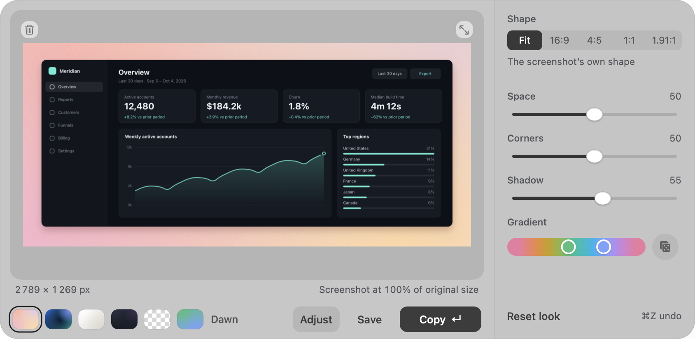

# PremiumShot for Mac

A screenshot, with a beautiful finish. Choose a background, tune the space, corners and shadow, then copy a PNG wherever you work.



*The native app with a synthetic dashboard. Dawn, Space, Corners and Shadow make the finish.*

A native menu-bar app for **macOS 26 on Apple Silicon**. Free, MIT-licensed, no account or analytics. Image processing stays on your Mac. This repository is the Mac source project; the Chrome extension and website are separate.

[](https://github.com/f-campana/premiumshot-mac/actions/workflows/ci.yml)

## What it looks like

The preview stays in one place while you try a look or adjust its finish. Inspect opens a larger view for checking details; Copy, Save and drag-out use the same composition. Clear preserves a transparent background, and Custom lets you choose two colours or randomize the pair.

## Use

Copy a screenshot, press <kbd>⌘</kbd> <kbd>⌥</kbd> <kbd>⇧</kbd> <kbd>Space</kbd>, then <kbd>Return</kbd> to copy the result. On first launch a short welcome explains the flow. Paste, drag an image into the panel, or choose **Open latest screenshot**.

- Six backgrounds: Dawn, Tide, Paper, Graphite, Clear and a two-colour Custom gradient.
- **E** opens Adjust for Shape, Space, Corners, Shadow and Custom colours.
- Focus the preview and press **Space** for Inspect: fit, actual size, zoom and pan.
- **Return / ⌘C** copies; **Save** writes a PNG; drag the preview into another app.
- **⌘Z / ⇧⌘Z** undoes and redoes recipe edits.
- The trash button removes the screenshot from the session and leaves its file and your clipboard alone.
- **Esc** closes Inspect first, then the panel.

Open at Login is optional and off by default. Paste and drop work without folder access. Open latest screenshot requests screenshots-folder access only when needed; denial leaves paste/drop usable and offers Privacy Settings or a folder picker.

## Build

Requires macOS 26, Xcode 26.6 (or a compatible Swift 6.2+ toolchain), and the macOS SDK. There are no third-party runtime dependencies.

```sh
make check
make app
open build/PremiumShot.app
```

The marketing version lives in [VERSION](VERSION), and the recorded date-based build number in [BUILD_NUMBER](BUILD_NUMBER). About reads both from the bundle.

`make app` creates an ad-hoc signed release app with the hardened runtime. It does not notarize it. `make release` runs the checks and packages a committed private beta as a DMG, checksum and manifest. See [release process](docs/release-process.md) and [beta installation](docs/beta-installation.md). Developer ID, notarization and automatic updates are deferred until beta feedback. No public release has been published.

## Development and verification

```sh
make dev-app
"build/Debug/PremiumShot Dev.app/Contents/MacOS/PremiumShotApp" --qa --image fixtures/wide-dashboard.png
"build/Debug/PremiumShot Dev.app/Contents/MacOS/PremiumShotApp" --welcome --snapshot /tmp/welcome.png
make cli
```

Debug builds use a separate bundle identifier. QA flags use private preferences and pasteboards. `--snapshot` captures hosted card content plus runtime bounds, not the desktop or motion. `--folder-denied` simulates a denied read for reviewing recovery; it does not establish a real privacy-permission test. Diagnostics are compiled out of release builds.

Tests cover rendering goldens, geometry, colour, native keyboard routing, import/output races, first launch and recovery. Run native window tests without simultaneous mouse/keyboard use. Real TCC prompts, login across a restart, VoiceOver, physical displays and drag destinations need native acceptance. Hosted captures do not replace those checks.

## Source

- `Sources/PremiumShotCore`: geometry, colour, decoding, rendering and PNG.
- `Sources/PremiumShotMac`: editor, native input, presentation, history and output.
- `Sources/PremiumShotApp`: lifecycle, menu, bundle links and DEBUG-only diagnostics.
- `Tools/pshot`: development-only renderer CLI for Chrome parity, built from a pinned revision and excluded from the app bundle.
- `Resources/AppIcon.icon`: original layered Icon Composer artwork.
- `Tests` and `fixtures`: synthetic inputs, regression tests and rendering references.

See [contributing](CONTRIBUTING.md), [agent instructions](AGENTS.md) and the [roadmap](docs/roadmap.md). Product additions stay outside release preparation.

## Feedback

Private beta feedback will use `support@premiumshot.app` once receiving and replying are verified. The current candidate keeps Send feedback unavailable until then. Include the app version from About, your macOS version and the steps to reproduce the problem. Keep private screenshots out of public issues.

Licensed under [MIT](LICENSE).
